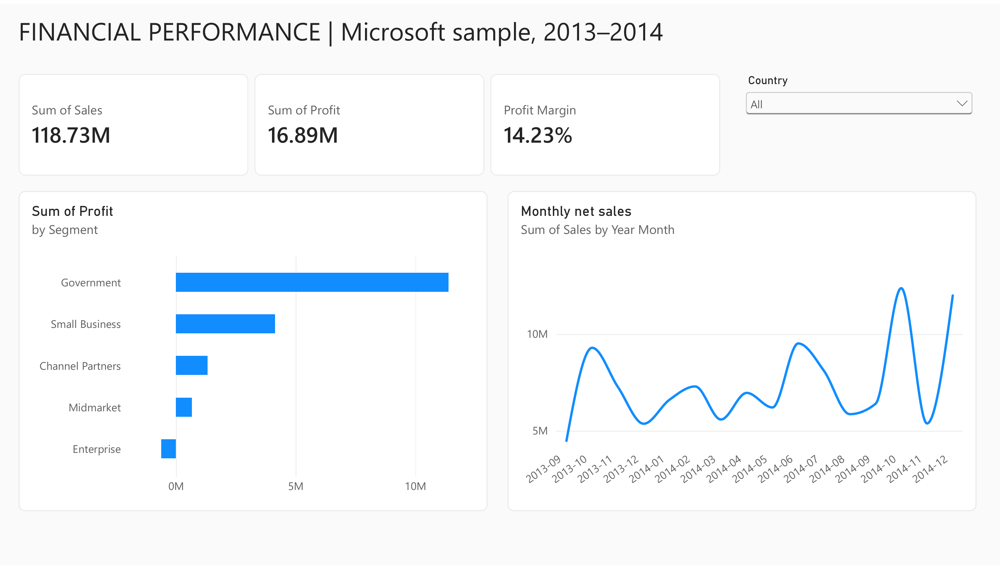

# Financial Performance: Sales, Profit and Discounts

**Power BI portfolio case study by Kautilya Patel**

Which segments drive profitable sales, and where do discounts and product mix warrant investigation?



## Explore the dashboards

- **[Download the editable Power BI report and data (.pbix)](reports/financial-performance.pbix)**
- **[View the four-page dashboard PDF](reports/financial-performance.pdf)**
- **[View the dedicated six-metric KPI dashboard](visuals/dashboard-4.png)** · [Open it in Power BI](https://app.powerbi.com/groups/me/dashboards/2f7949a1-e149-4626-896f-870caa3c12e1?experience=power-bi)
- [Read the findings and proposed business actions](reports/findings.md)
- [Product and country dashboard](visuals/dashboard-2.png) · [Discount and margin dashboard](visuals/dashboard-3.png)
- [KPI definitions and DAX](docs/measures.dax) · [Power Query source](docs/financials.pq)
- [Analysis and reconciliation code](scripts/analyze.py) · [Machine-readable results](reports/analysis.json)

The report was authored in the Power BI service and exported as a native PBIX with its data. It contains four interactive pages: **Executive Overview**, **Products and Countries**, **Discounts and Margin**, and **KPI Dashboard**. The first three combine KPI cards, a country dropdown and focused comparison charts. The monthly trend uses chronological year-month sorting. The dedicated KPI page shows net sales, profit, weighted profit margin, discounts, weighted discount rate and units sold in a two-row grid. It is also saved as a separate Power BI dashboard with a live page tile and country filtering.

The PBIX can be opened in Power BI Desktop. GitHub can display the PDF and PNG previews without a Power BI account. Power BI service links require the appropriate account and access; the report has not been made public through Publish to web.

## Findings that matter

| Question | Observed result | Proposed next step |
| --- | --- | --- |
| Are all sales profitable? | Enterprise: 19.61M sales, -0.61M profit, -3.13% margin | Review loss concentration and commercial terms |
| Which segment contributes most profit? | Government: 11.39M profit on 52.50M sales | Examine sustainable product and market mix |
| Does the highest-sales country have the highest margin? | United States leads sales, but Germany leads country margin | Compare cost, discount and segment mix |
| How do discount groups differ? | High-discount margin 9.07%; no-discount margin 21.86% | Compare within comparable groups before testing a policy change |

These are descriptive findings from sample data. No causal effect, implemented recommendation or measured business improvement is claimed.

## Baseline and metric definitions

The source has 700 records, five countries, five segments and six products across September 2013–December 2014. Total net sales are **118,726,350.26**, profit is **16,893,702.26**, and profit margin is **14.23%**. Monetary figures retain the workbook's source convention; no currency conversion is applied. Profit is Sales minus COGS, not audited net income.

**Profit margin = SUM(Profit) / SUM(Sales)**, rather than an average of row margins. **Discount rate = SUM(Discounts) / SUM(Gross Sales)**. The literal `None` discount-band category is preserved. The analysis trims source header/category whitespace and validates date fields and accounting identities.

2013 includes only September–December. The written report compares those same months with 2014 rather than calling a partial-year/full-year difference annual growth.

## Reproduce and review

```bash
git clone https://github.com/patelkautilya/financial-performance-powerbi.git
cd financial-performance-powerbi
python -m venv .venv
# Activate .venv using your operating system's command.
pip install -r requirements.txt
python scripts/analyze.py
```

The script downloads Microsoft's original workbook when absent, validates the 700-row source, generates clean CSV and segment/product/country/discount summaries, and independently reconciles sales, profit and discounts with SQLite. The workbook SHA-256 is recorded in `reports/analysis.json`. The original sample workbook is an unchanged download, not an authored Excel report.

For Power BI, the PBIX includes its model and report. [Documented DAX](docs/measures.dax) matches the two measures entered in the service. [Power Query](docs/financials.pq) records the source and cleaning logic used in the service. Local CSV regeneration does not automatically refresh a report in the Power BI service; refresh and re-export explicitly if the source changes.

## Validation

- All 700 rows reconcile Gross Sales - Discounts = Sales and Sales - COGS = Profit.
- Units Sold × Sale Price reconciles to Gross Sales, and date year/month fields agree.
- Independent SQLite totals agree with pandas analysis.
- Power BI unfiltered cards show 118.73M sales, 16.89M profit and 14.23% margin.
- Selecting Canada shows 24.89M sales, 3.53M profit and 14.18% margin, matching the independent country summary. The default was restored to all countries.
- The dedicated KPI page also reconciles Canada discounts (2.04M), discount rate (7.59%) and units sold (247,428.5). Fractional units are preserved when filtering.
- The exported PBIX contains four 1280 × 720 pages and 19 visual containers. The PDF pages were rendered and visually reviewed.

## Source and scope

[Microsoft Financial Sample documentation and download](https://learn.microsoft.com/en-us/power-bi/create-reports/sample-financial-download). This project uses public sample business data for a portfolio demonstration. Dataset rights remain with the source; no new license is asserted over Microsoft's data or Power BI components. The sample has no customer/order keys, no overhead or marketing costs and only 16 months of history.

[GitHub profile](https://github.com/patelkautilya) · [LinkedIn](https://www.linkedin.com/in/patelkautilya/)
